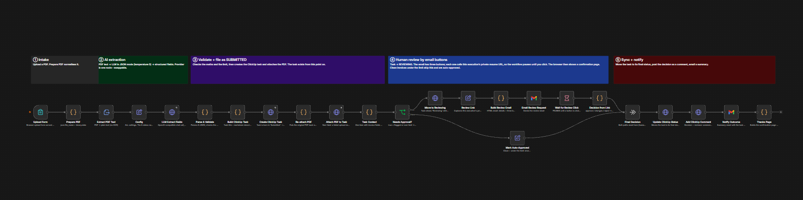
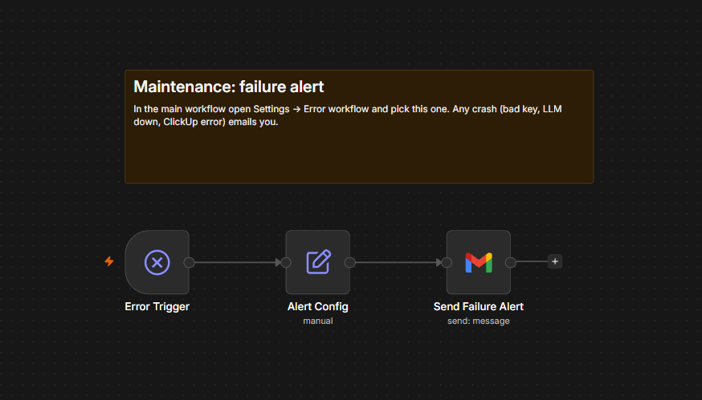

# Invoice Intake and Approval Automation

An n8n workflow that turns an uploaded PDF invoice into a tracked ClickUp task. An LLM extracts the invoice data, validation rules check it, and a reviewer approves or rejects it with one click from an email. ClickUp always shows the current stage of every invoice.

## How it works

1. A user uploads a PDF invoice through a form served by n8n.
2. The text is extracted and sent to an LLM (Groq, JSON mode, temperature 0), which returns vendor, invoice number, date, currency, subtotal, tax, total, line items and a summary.
3. Validation rules check the data. Clean invoices under the approval limit are approved automatically. Everything else goes to a reviewer.
4. A ClickUp task is created as Submitted and the original PDF is attached.
5. If review is needed, the task moves to Reviewing and the reviewer receives an email with three buttons: Approve, Request changes, Reject. The workflow pauses until a button is clicked.
6. The click moves the task to Approved, Changes Needed or Rejected, adds the decision as a comment, and sends a confirmation email with the task link.

## ClickUp statuses

Submitted, Reviewing, Changes Needed, Approved, Rejected.

## Validation rules

- Vendor, invoice number and total are present, and the total is greater than zero
- Line items add up to the subtotal
- Subtotal plus tax equals the total
- The invoice date is valid and not in the future
- The PDF contains readable text
- The total is within the auto-approve limit (default 500)

If any rule fails, or the total is above the limit, a human reviews the invoice.

## Review email

Each button calls the private resume URL of the paused n8n execution, so it works once. If nobody clicks before the timeout (default 120 minutes), the task stays in Reviewing and a comment records that no decision was received.

## Reliability and maintenance

- Retries on the LLM call and the ClickUp task creation
- The PDF attachment step is non-fatal, so a failed upload never stops the run
- Timeout handling leaves the task in Reviewing instead of deciding for the reviewer
- A separate error workflow emails you when any run fails
- All settings live in one Config node

## Tech stack

n8n (self-hosted in Docker), Groq LLM API, ClickUp API v2, Gmail (OAuth2).

## Files

- `invoice_pipeline_clickup_buttons.n8n.json` - main workflow
- `invoice_error_alert_gmail.n8n.json` - error alert workflow

## Setup

1. Create a ClickUp List with the five statuses above, spelled exactly the same. The List ID is the number after `/li/` in its URL.
2. Import both JSON files into n8n.
3. Create a Gmail OAuth2 credential (Google Cloud project with the Gmail API enabled) and select it on every Gmail node in both workflows.
4. Fill in the Config node:

| Field | Description |
| --- | --- |
| `groq_api_key` | Groq API key |
| `approver_email` | Address that receives review emails |
| `clickup_api_token` | ClickUp personal API token |
| `clickup_list_id` | ID of the target List |
| `auto_approve_limit` | Totals above this always need review (default 500) |
| `approval_timeout_minutes` | How long to wait for a click (default 120) |

5. Set your email in the Alert Config node of the error workflow, then select it as the Error workflow in the main workflow settings.
6. Open the Upload Form URL and upload a text-based PDF.

## Testing tips

- Use the buttons from the newest review email only, and click once. Links in older emails belong to finished runs and return a 409 error.
- Set `approval_timeout_minutes` to a small value to see the no-response path.

## Limitations

- On a local n8n install the buttons work on the same computer that runs n8n. Other devices need a public n8n URL.
- PDFs must contain real text. There is no OCR.
- Request changes does not reopen the task. Upload a corrected invoice to create a new one.
- Changing the LLM provider means changing the URL, model and key in the LLM node. OpenAI-compatible providers work directly. Others, including Claude, need the request body adjusted.

## Security

The workflow stores API keys in the Config node for simplicity, and the exported JSON contains placeholders only. Add your own keys after importing, never commit real ones, and consider n8n credentials for production use.
